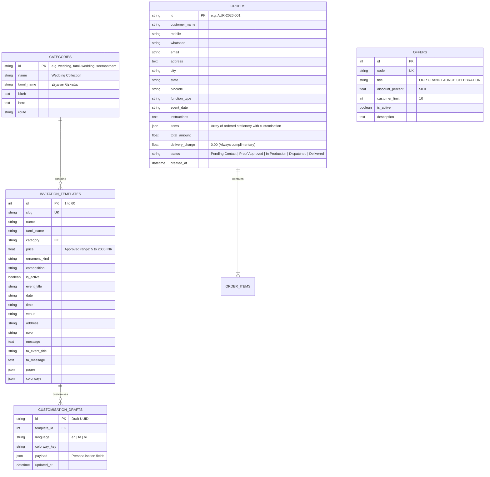

# DATABASE SCHEMA — AURELIA: THE INVITATION WORLD

## 1. Engine & Configuration
- **Database Engine**: PostgreSQL (Production) / SQLite (Local & Development)
- **ORM**: SQLAlchemy 2.0+
- **Dialect Support**: UTF-8 full Unicode support for Tamil scripts and special characters.

---

## 2. Entity Relational Diagram

---

## 3. Data Integrity & Constraints
1. **Pricing Rule**: Unit price must strictly reside between ₹5 and ₹2,000 INR.
2. **Delivery Fee Invariance**: `delivery_charge` default is fixed at `0.00` INR (Free Delivery Guarantee).
3. **Multilingual Consistency**: Content records store paired English and Unicode Tamil text fields (`ta_event_title`, `ta_message`, `ta_host`, `ta_couple`).
4. **Privacy Protection**: Client mobile numbers, addresses, and personal details are segregated behind authorized administrator endpoints.

